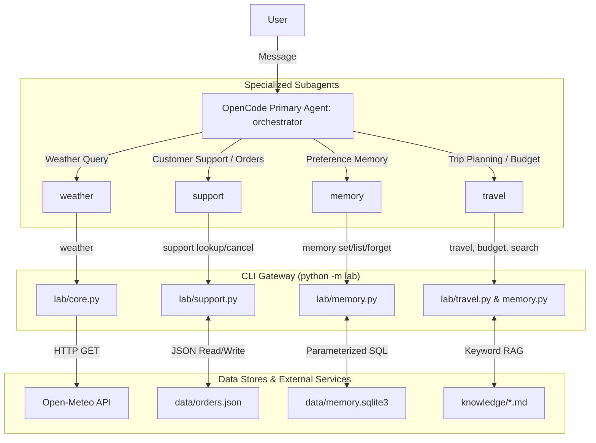
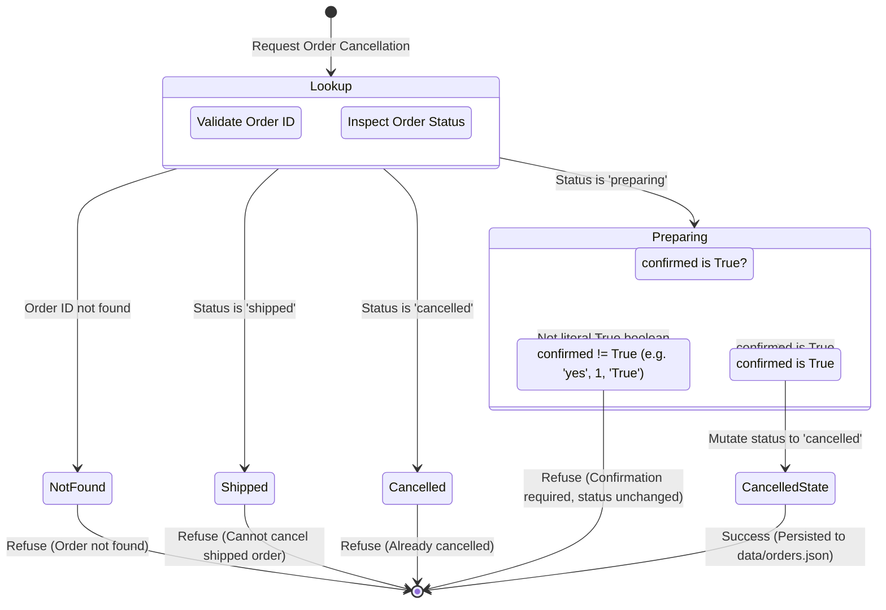
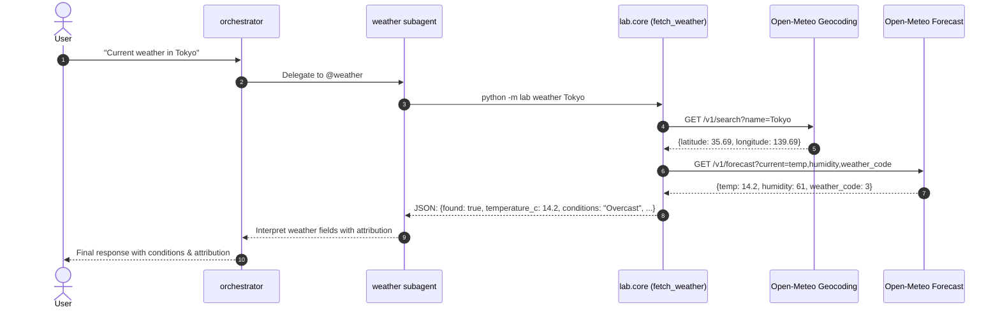
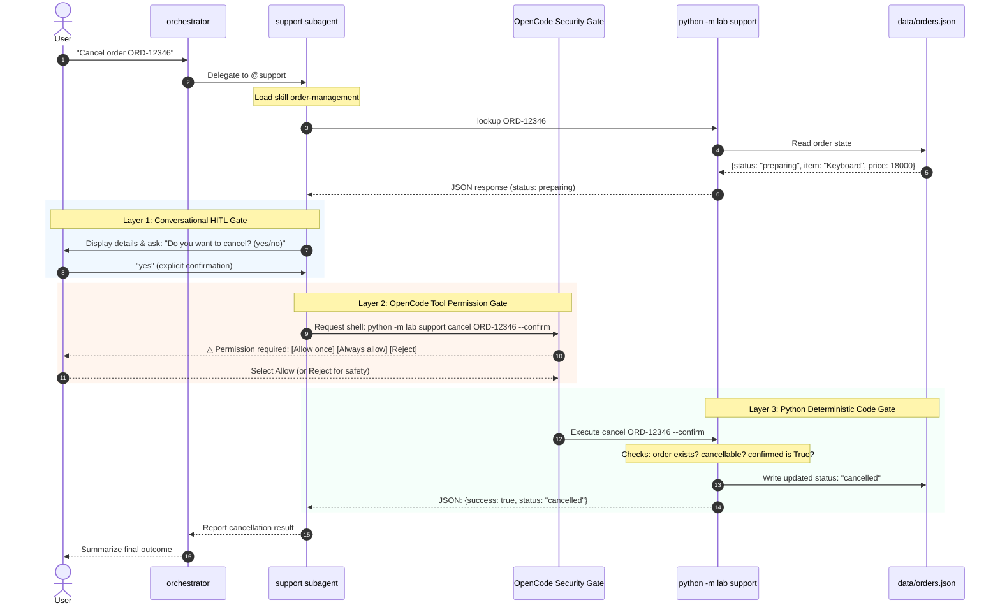
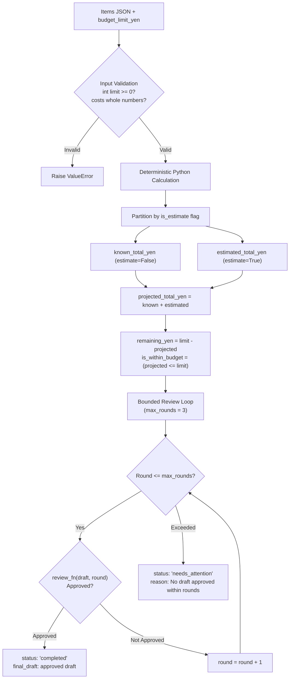

# System solution

## Purpose and scope

This capstone implements an offline-first travel and customer-support assistant
with a command-line boundary. OpenCode's orchestrator delegates requests to
weather, travel, support, and memory agents. Domain operations are performed by
`python -m lab`; the language model does not own application state or calculate
budgets.

## Components and request flow



1. The OpenCode primary agent routes a user request to one domain subagent.
2. Agent instructions restrict shell access to the matching `lab` CLI commands.
   The support agent must look up an order and request explicit approval before
   an irreversible cancellation.
3. `lab.__main__` parses commands and returns JSON with the documented exit
   codes: 0 for success, 1 for refusal/not found, and 2 for invalid usage.
4. Domain modules handle API access, deterministic budget arithmetic,
   cancellation checks, SQLite memory, and local keyword retrieval.
5. Local documents in `knowledge/` provide cited retrieval results. Place search
   is evaluated by `eval/place_queries.json`.

## Module responsibilities

| Module | Responsibility | Reliability boundary |
|---|---|---|
| `lab/core.py` | Open-Meteo geocoding and current weather | Uses a single HTTP helper; returns structured failures for network and malformed responses |
| `lab/travel.py` | Budget summary and bounded review loop | Validates integer yen amounts; computes confirmed and estimated totals in Python; limits rounds |
| `lab/support.py` | Demo order lookup and cancellation | Blocks unknown, shipped, and already-cancelled orders; mutates state only for literal `True` confirmation |
| `lab/memory.py` | Scoped preferences and local document search | Parameterized SQLite statements; user/scope/key isolation; deterministic token scoring |
| `lab/__main__.py` | JSON CLI | Normalizes inputs/outputs and enforces the CLI exit-code contract |

## State and data

- Preferences are stored in SQLite at `LAB_DB_PATH`, defaulting to
  `data/memory.sqlite3`. Records are keyed by user, scope, and preference key.
- The demo order state is persisted in `data/orders.json`; `support reset`
  restores the supplied sample orders.
- Knowledge documents live in `knowledge/`. The place file has bilingual names
  and six structured fields per place. Search tokenizes English words and
  overlapping two-character Japanese sequences, then ranks documents by the
  number of distinct query tokens they share. Stable ordering resolves ties.
- The OpenCode project configuration selects the OpenAI-compatible Ollama
  endpoint at `http://172.16.125.141:11434/v1` and model `mimo-v2.6:9b`.
  `.env.example` records the endpoint, model, and database path; `.env` is
  ignored by Git and is not auto-loaded by OpenCode or Python. Keep the model
  endpoint in `opencode.json` synchronized with the environment file.

## Safety and failure handling



- Budget limits must be non-negative integers. Each item must have a finite,
  non-negative whole-number cost and a boolean estimate flag. Estimates count
  toward the projected budget but remain separately visible.
- Reviews stop at the first approval and never exceed the configured round
  ceiling. Exhaustion and empty input return `needs_attention`.
- Cancellation checks order existence and status before checking confirmation.
  A refused request leaves the order unchanged.
- SQLite queries use placeholders, and scoped keys prevent one user's
  preference reads/deletes from affecting another user or scope.
- Retrieval treats text as data. It is local keyword matching, not an
  instruction interpreter or a semantic/vector search system.
- Weather service and malformed-response errors are returned as JSON failures;
  no API key is required for Open-Meteo.

## Running and verification

Install `requirements.txt`, then run:

```text
python -m lab doctor
python -m pytest -v
python -m lab search-eval
```

OpenCode interactive demonstrations require the OpenCode CLI and a reachable
Ollama service with the configured model. Their outcomes should only be
recorded after running those demonstrations.

## Known limitations

- Keyword search has no synonym expansion, stemming, semantic embeddings, or
  reranker; the evaluation file exposes its behavior and misses.
- The order and preference stores are local demonstration state, not a
  production commerce service.
- Weather responses depend on Open-Meteo availability and geocoding quality.
- The project cannot prove the identity or provenance of a model loaded on the
  configured Ollama server; that endpoint must be verified by the operator.

## Agent anatomy and collaboration

An agent is a saved prompt, a mode, and a set of tool permissions. It is not a
separate Python service or a database. OpenCode gives the primary
`orchestrator` the user's message; the orchestrator chooses a specialist,
sends it a self-contained request using the subagent tool, waits for its
response, and then summarizes the result. A child agent starts with focused
context, so the orchestrator should include the city, order ID, or preference
that matters.

| Agent | Mode | What it owns | Allowed actions |
|---|---|---|---|
| `orchestrator` | primary | Route user intent and combine specialist answers | Delegate to the four named agents; `lab doctor` |
| `weather` | subagent | Live current conditions and attribution | `python -m lab weather ...` |
| `travel` | subagent | Preferences, local guidance, itinerary review | `travel`, `budget`, `search`, preference `list`, bounded web research |
| `support` | subagent | Order lookup, policy and review analysis | Lookup/search; cancellation permission is `ask` |
| `memory` | subagent | Explicit, non-sensitive preference lifecycle | `memory set/list/forget` |

`.opencode/agents/<name>.md` supplies the agent-specific role prompt. The
frontmatter declares its description, mode, and permissions. `.opencode/skills`
stores reusable procedures such as how to cancel an order safely. The
orchestrator is configured as the default in `opencode.json`.

The project `opencode.json` also applies V2 permission rules: the wildcard
action is denied first, then only required subagent, CLI, web, skill, and
question actions are explicitly enabled. Cancellation remains an `ask` action.
This matters because V2 permission names are `permissions`, `shell`, and
`subagent`; V1 used `permission`, `bash`, and `task`. Existing Markdown
frontmatter is still loaded by OpenCode v2.2.6, while the JSON rules tighten
the tool boundary.

## Follow one request through the code

### Example: current weather



1. The user says "Tokyo".
2. `orchestrator` routes to `weather`.
3. The weather prompt tells the specialist to call the CLI rather than
   estimate or invent conditions.
4. `lab/__main__.py` parses `weather Tokyo` and enters `cmd_weather`.
5. `cmd_weather` calls `lab.core.fetch_weather`.
6. `fetch_weather` validates the city, calls `_get_json()` for geocoding, then
   calls `_get_json()` again for current forecast values.
7. The CLI serializes one JSON object. The agent turns those returned fields
   into prose and includes the attribution.

### Example: a safe cancellation



1. The support specialist loads `order-management`.
2. It calls `support lookup ORD-12346`; `lookup_order` normalizes the ID.
3. It displays the returned item, price, and current status, then asks the
   user for explicit confirmation.
4. Only after a clear yes should it request `support cancel ... --confirm`.
5. OpenCode separately asks permission for the shell command. In Python,
   `cancel_order` checks existence/status and requires `confirmed is True`
   before changing the in-memory order.
6. The CLI handler saves the order JSON so a later command sees the new state.

There are therefore two independent checks: conversational user approval and
the OpenCode shell permission. The Python check is a final deterministic
guardrail, not a substitute for asking.

### Example: travel budget



The LLM researches and drafts, but sends item objects to `cmd_budget`. The
handler parses JSON, then `compute_budget_summary` validates each cost and
estimate flag. Python computes confirmed, estimated, and projected totals.
`run_bounded_review` calls its reviewer on successive drafts and returns
`needs_attention` if the maximum rounds pass without approval.

### Example: scoped memory and local RAG

`set_preference` validates required strings and executes a parameterized
SQLite upsert under `(user_id, scope, key)`. `forget_preference` deletes only
that same composite key. `search_knowledge` loads Markdown chunks, builds
search text with source/title, calls `simple_keyword_rag`, then returns the
original chunks so an agent can cite the filename.

## Code reading guide

Start at `build_parser()` in `lab/__main__.py`: it declares the commands and
maps each to a `cmd_*` function. Follow one handler to a domain function, then
read the relevant unit test beside it. This is easier than reading all modules
at once.

| File | Beginner's question to answer |
|---|---|
| `lab/__main__.py` | How does text such as `support lookup ID` become a JSON response? |
| `lab/core.py` | What are the two weather HTTP calls, and what happens if either fails? |
| `lab/travel.py` | Why are yen totals deterministic, and how is the loop ceiling enforced? |
| `lab/support.py` | Which statuses are blocked before the confirmation boolean is checked? |
| `lab/memory.py` | Which columns isolate users, and how are Japanese pairs scored? |
| `.opencode/agents/` | Which agent should handle a request, and which tools can it call? |
| `.opencode/skills/` | What procedure must be followed for a specific support action? |
| `tests/test_capstone.py` | Which concrete inputs prove each behavior? |

## WSL installation, configuration, and daily use

Use the Linux repository path, `/home/ducanh/lab7-starter`. The WSL system
Python was 3.10, below this project's Python >=3.11 requirement. `uv` was used
to install Python 3.11.18 into the user account without replacing Ubuntu's
system Python:

```bash
cd /home/ducanh/lab7-starter
uv python install 3.11
uv venv --python 3.11 .venv
uv pip install --python .venv/bin/python -r requirements.txt
source .venv/bin/activate
python --version
python -m lab doctor
python -m pytest -q
python -m lab search-eval
```

`.venv/` is ignored by Git. OpenCode was installed using the official Linux
installer and reported version 2.2.6:

```bash
curl -fsSL https://opencode.ai/v2/install | bash
export PATH="$HOME/.opencode/bin:$PATH"
opencode --version
```

Before starting OpenCode, make sure the server and model are reachable:

```bash
curl -fsS http://172.16.125.141:11434/api/tags
```

For a run whose child shell must inherit the current environment, use
`--standalone`. Put the project venv and OpenCode executable on PATH:

```bash
export PATH="/home/ducanh/lab7-starter/.venv/bin:$HOME/.opencode/bin:$PATH"
opencode --standalone
```

The default provider/model and permissions are in `opencode.json`. `.env`
documents `OLLAMA_BASE_URL`, `OLLAMA_MODEL`, and `LAB_DB_PATH`, but it is not
automatically loaded: Ollama's URL must also be set in `opencode.json`.

## Design limitations

This keyword RAG is intentionally small and inspectable; it is not a vector
database, and the curated evaluation set is not a universal accuracy measure.
Weather depends on Open-Meteo. Orders are local demo state. The Ollama tag
confirms a server response and model name, not model provenance. A headless
`opencode run` cannot supply a human's answer to an interactive approval
question; do not describe that as a completed cancellation confirmation.
