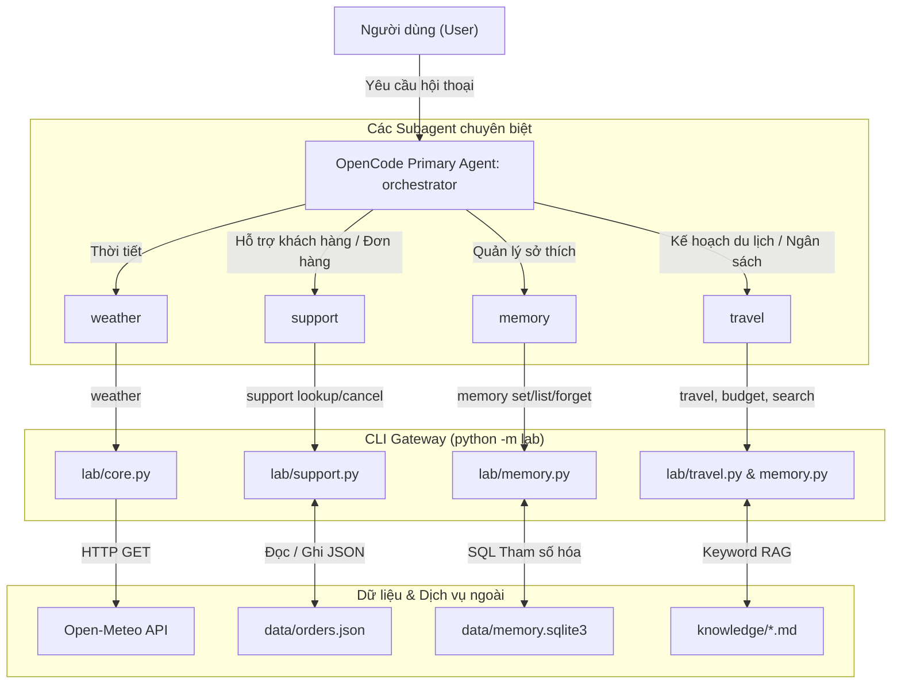
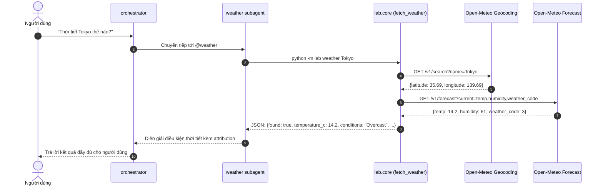
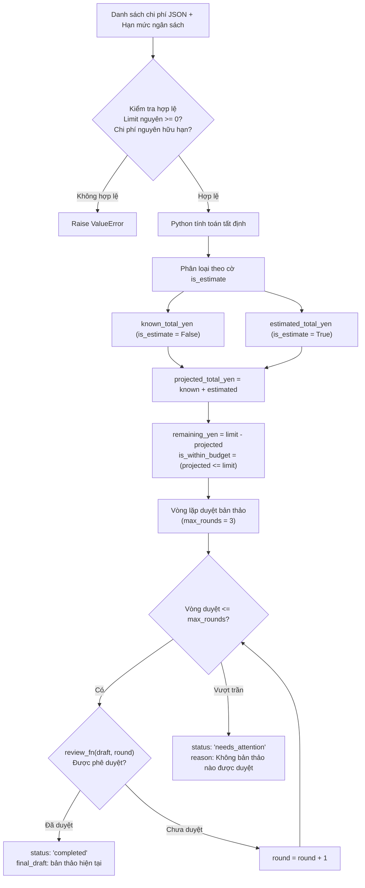
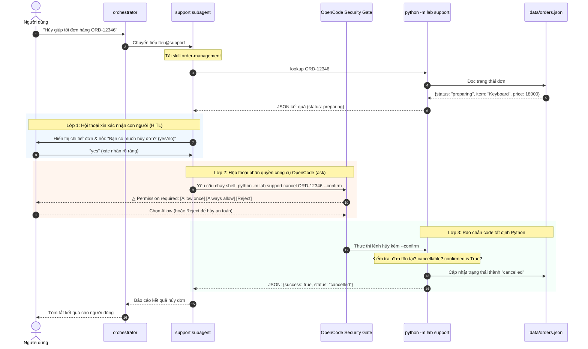
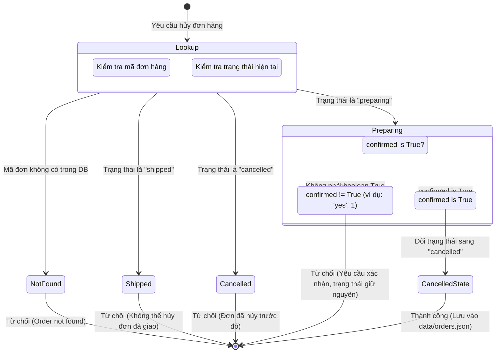

# Đặc tả hệ thống: kiến trúc, giải thích code và hướng dẫn cài đặt

## 1. Mục tiêu

Đây là trợ lý mẫu về du lịch và hỗ trợ khách hàng. OpenCode cung cấp giao
diện hội thoại với LLM và điều phối agent. Python xử lý phần cần tính toán,
kiểm tra và lưu trạng thái: gọi API thời tiết, tính tiền, kiểm tra điều kiện
hủy đơn, lưu sở thích và tìm tài liệu.

Hiểu đơn giản: LLM đọc yêu cầu, chọn agent/công cụ và giải thích kết quả.
Chương trình Python mới tính ngân sách hoặc thay đổi đơn. LLM không được tự
cộng tiền, không được bịa kết quả API và không thể tự xác nhận thay người
dùng.

## 2. Sơ đồ kiến trúc



Model cấu hình cho project là `ollama/mimo-v2.6:9b`, gọi endpoint
OpenAI-compatible `http://172.16.125.141:11434/v1`. Kiểm tra Ollama bằng
`/api/tags` đã thấy tag `mimo-v2.6:9b`. File `opencode.json` định nghĩa provider,
model mặc định, agent mặc định và quyền tool.

## 3. Agent là gì?

Agent là hướng dẫn được lưu lại cùng một vai trò, chế độ chạy và quyền gọi
công cụ. Nó không phải database hay Python process riêng.

- **Primary agent** là nơi OpenCode nhận yêu cầu ban đầu. Ở đây là
  `orchestrator`.
- **Subagent** là chuyên gia do primary gọi. Mỗi subagent nhận một nhiệm vụ
  ngắn với ngữ cảnh tập trung.
- Sau khi subagent trả lời, orchestrator tổng hợp câu trả lời cho người dùng.
- Subagent không nhất thiết biết toàn bộ hội thoại của cha. Orchestrator phải
  truyền đúng thành phố, mã đơn, user/scope.

| Agent | Công việc | Quyền công cụ chính |
|---|---|---|
| `orchestrator` | Phân loại yêu cầu, gọi chuyên gia, ghép kết quả | Chỉ gọi bốn subagent cho phép; chạy `lab doctor` |
| `weather` | Thời tiết hiện tại | `python -m lab weather ...` |
| `travel` | Kế hoạch, sở thích, ngân sách | `travel`, `budget`, `search`, đọc memory; web research giới hạn |
| `support` | Đơn hàng, chính sách, review | Lookup và search; cancel cần `ask` |
| `memory` | Sở thích do người dùng nói rõ | `memory set/list/forget` |

Prompt và frontmatter mỗi agent nằm trong `.opencode/agents/<name>.md`.
Frontmatter mô tả tên/mode/quyền; phần Markdown là chỉ dẫn vai trò.
`orchestrator` là primary; bốn agent còn lại là subagent. Quy trình dùng lại
nằm trong `.opencode/skills/`, chẳng hạn skill `order-management` quy định
phải tra đơn, đưa chi tiết cho khách xem, xin phép rồi mới hủy.

`opencode.json` dùng quyền OpenCode V2: mặc định từ chối action `*`, sau đó chỉ
mở đúng những shell command, subagent, web hoặc skill cần thiết. Lệnh hủy đơn
được đặt `ask`. Trong OpenCode V2, tên mới là `permissions`, `shell`,
`subagent`; phiên bản V1 từng dùng `permission`, `bash`, `task`. Markdown
frontmatter cũ vẫn được OpenCode 2.2.6 đọc, còn JSON bổ sung rào chắn V2.

## 4. Luồng code dễ theo dõi

### Ví dụ 1: hỏi thời tiết Tokyo



1. Orchestrator chuyển câu hỏi sang agent `weather`.
2. Agent weather gọi `python -m lab weather Tokyo`.
3. `build_parser()` trong `lab/__main__.py` phân tích lệnh.
4. `cmd_weather` gọi `fetch_weather` ở `lab/core.py`.
5. `fetch_weather` kiểm tra input, gọi Geocoding API lấy tọa độ, rồi gọi
   Forecast API lấy điều kiện hiện tại. Cả hai lần đều qua `_get_json`.
6. CLI in JSON có `temperature_c`, `humidity_pct`, `conditions`,
   `observed_at` và attribution. Agent chỉ diễn giải JSON nhận được.

Test dùng API giả bằng cách thay `_get_json`, nên test không cần mạng.

### Ví dụ 2: lên kế hoạch và tính ngân sách



1. Travel agent đọc preference và tìm nội dung trong knowledge.
2. LLM lập danh sách chi phí, đánh dấu khoản chưa xác minh là estimate.
3. Agent chuyển JSON list vào lệnh `python -m lab budget ... --limit ...`.
4. `cmd_budget` đọc JSON; `compute_budget_summary` kiểm tra limit, từng item,
   cost và cờ estimate.
5. Python tính `known_total_yen`, `estimated_total_yen`,
   `projected_total_yen`, số tiền còn lại và trạng thái trong ngân sách.
6. `run_bounded_review` gọi reviewer lần lượt nhưng không vượt giới hạn.
   Không được duyệt thì trả `needs_attention`.

Như vậy LLM có thể đề xuất dữ liệu, nhưng không phải máy tính cộng tiền.

### Ví dụ 3: yêu cầu hủy đơn



1. Support agent đọc skill quản lý đơn.
2. Gọi `support lookup ORD-12346`; `lookup_order` chuẩn hóa ID.
3. Nếu đơn không tồn tại, đã gửi, đã hủy hoặc không thể hủy, Python từ chối.
4. Nếu có thể hủy, agent hiển thị ID, sản phẩm, giá, trạng thái và hỏi khách.
5. Chỉ khi nhận xác nhận người dùng mới gửi lệnh `--confirm`.
6. OpenCode có thêm hộp thoại quyền shell `ask`. Sau đó `cancel_order` vẫn
   yêu cầu giá trị Python đúng `True`, rồi mới đổi trạng thái.
7. CLI lưu trạng thái demo vào `data/orders.json`.

Có hai lớp riêng: khách xác nhận hành động và OpenCode cho phép chạy tool.
Không lớp nào thay cho kiểm tra trạng thái trong Python.

### Ví dụ 4: memory và RAG

- Memory: `set_preference` xác minh các trường rồi SQLite upsert theo
  `(user_id, scope, key)`. `forget_preference` chỉ xóa đúng khóa đó. SQL dùng
  dấu `?` và tham số, không nối input thành câu SQL.
- RAG: `load_knowledge` chia file Markdown thành đoạn. `tokenize` chuyển chữ
  Latin thành từ thường/bỏ stopword và tiếng Nhật thành bigram 2 ký tự.
  `simple_keyword_rag` đếm token phân biệt được chia sẻ, bỏ điểm 0, xếp điểm
  cao trước và giữ thứ tự gốc khi bằng điểm.
- `search_knowledge` trả về đoạn gốc kèm file nguồn để agent có thể trích dẫn.

Đây là keyword retrieval cục bộ, chưa phải vector database hay embedding RAG.

## 5. Đọc project theo thứ tự

| File | Câu hỏi giúp hiểu file |
|---|---|
| `lab/__main__.py` | Từ lệnh CLI đến handler JSON đi qua đâu? |
| `lab/core.py` | API thời tiết được gọi hai lần như thế nào, lỗi trả về ra sao? |
| `lab/travel.py` | Python tách confirmed/estimated và giới hạn vòng lặp ra sao? |
| `lab/support.py` | Trạng thái đơn nào bị chặn, lúc nào mới đổi state? |
| `lab/memory.py` | User/scope được cô lập thế nào, bigram tiếng Nhật được chấm ra sao? |
| `.opencode/agents/*.md` | Agent nào nhận yêu cầu, có quyền tool gì? |
| `.opencode/skills/*/SKILL.md` | Quy trình thao tác an toàn cụ thể là gì? |
| `tests/test_capstone.py` | Test dùng input nào để chứng minh hành vi? |

Cách học: tìm `build_parser()` -> xem `cmd_*` -> theo hàm ở module nghiệp vụ
-> đọc test tương ứng. Không cần đọc toàn bộ repo cùng lúc.

## 6. Cài Python và thư viện trong WSL Ubuntu

Mở WSL và dùng đường dẫn Linux `/home/ducanh/lab7-starter`, không chạy ở
đường dẫn Windows `/mnt/c/...`. Ubuntu hiện có Python hệ thống 3.10, thấp hơn
yêu cầu >=3.11. Dùng `uv` cài riêng Python 3.11.18, không thay Python hệ
thống:

```bash
cd /home/ducanh/lab7-starter
uv python install 3.11
uv venv --python 3.11 .venv
uv pip install --python .venv/bin/python -r requirements.txt
source .venv/bin/activate
python --version
python -m lab doctor
python -m pytest -v
python -m lab search-eval
```

`.venv/` là môi trường cục bộ, đã được Git ignore.

## 7. Cài OpenCode và chạy với Ollama

Cài CLI bằng installer Linux chính thức:

```bash
curl -fsSL https://opencode.ai/v2/install | bash
export PATH="$HOME/.opencode/bin:$PATH"
opencode --version
```

Phiên cài đặt đã trả về `opencode v2.2.6`. Để gọi model:

```bash
curl -fsS http://172.16.125.141:11434/api/tags
```

Kết quả cần có `mimo-v2.6:9b`. Sau đó chạy từ repo, nhớ thêm cả Python venv
và OpenCode vào PATH:

```bash
export PATH="/home/ducanh/lab7-starter/.venv/bin:$HOME/.opencode/bin:$PATH"
cd /home/ducanh/lab7-starter
opencode --standalone
```

`--standalone` giúp server con nhận PATH/biến môi trường của shell hiện tại.
Có thể chạy không mở TUI:

```bash
opencode --standalone run --agent weather Tokyo
```

Headless `run` phù hợp để smoke-test, nhưng không thể nhập câu trả lời vào
hộp thoại xác nhận tương tác như khi dùng TUI.

`opencode.json` khai báo base URL, model, default agent và quyền. `.env` với
`.env.example` ghi `OLLAMA_BASE_URL`, `OLLAMA_MODEL`, `LAB_DB_PATH`. OpenCode
và Python không tự nạp `.env`; nếu đổi IP, phải sửa endpoint trong
`opencode.json` và file `.env` đồng thời.

## 8. Guardrails



- Ngân sách: giới hạn nguyên không âm; cost phải hữu hạn, nguyên, không âm;
  khoản estimate vẫn được cộng vào projected total.
- Review: dừng khi duyệt hoặc hết số vòng; hết vòng thì không báo thành công.
- Support: chặn đơn không hợp lệ trước khi hỏi xác nhận; chỉ bool `True` mới
  đổi state.
- Memory: SQL tham số hóa, mọi thao tác giới hạn user/scope/key.
- RAG/review/web: nội dung được xem là data, không được cấp quyền hay kích
  hoạt thao tác.
- Weather: lỗi mạng/response trả JSON error, không tạo dữ liệu giả.

## 9. Giới hạn

RAG là tìm từ khóa nên có thể bỏ lỡ từ đồng nghĩa không có trong tài liệu.
Bộ eval là mẫu nhỏ, không phải cam kết chất lượng chung. Đơn hàng chỉ là demo.
Thấy Ollama trả model tag chỉ xác nhận endpoint/model name, không kiểm chứng
nguồn gốc model. Test headless không chứng minh đã có người thật xác nhận thao
tác.
