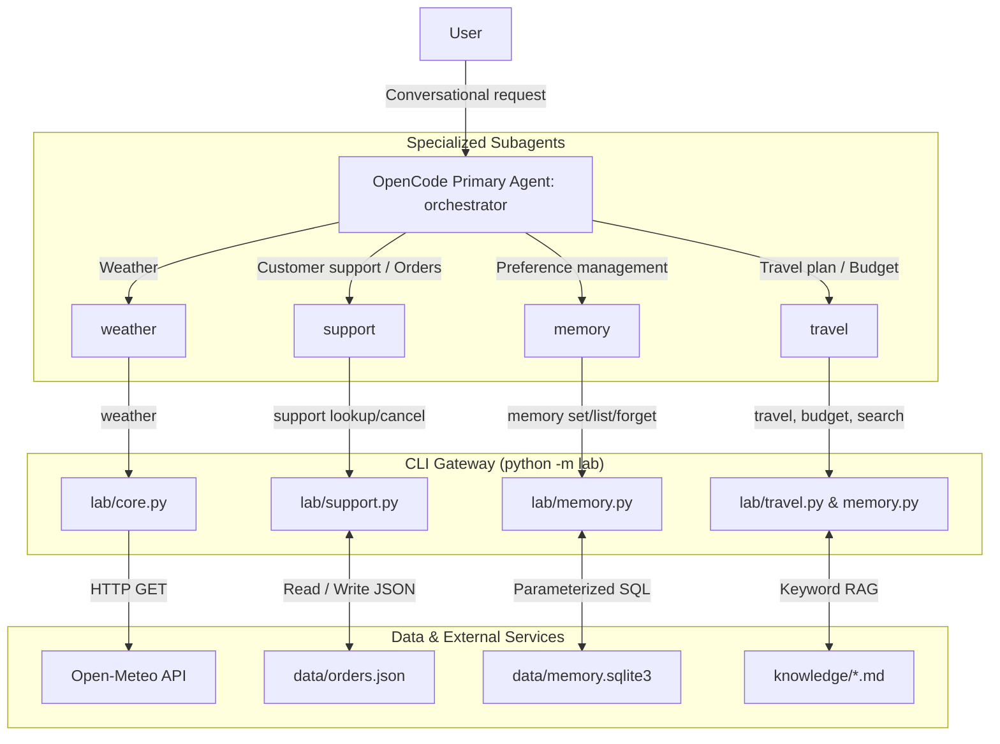
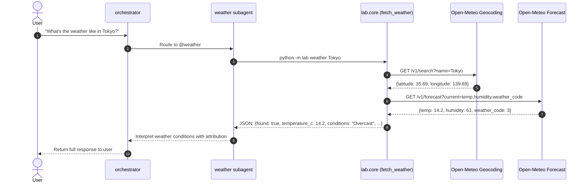
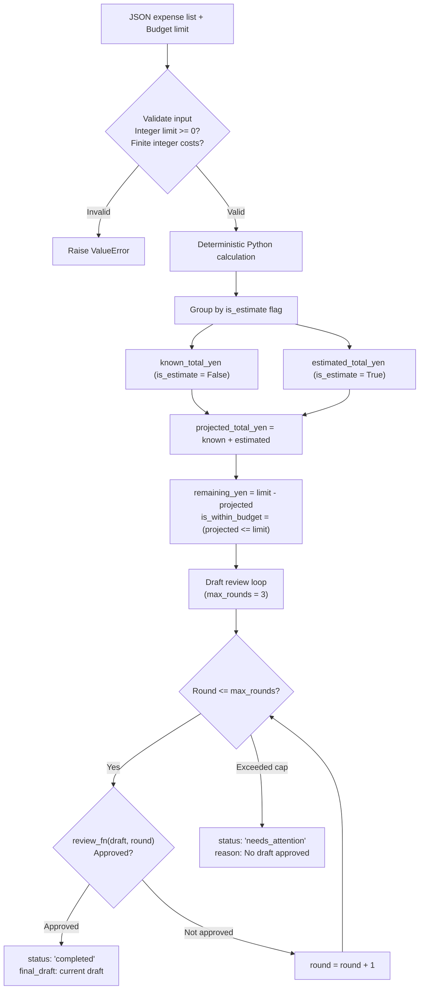
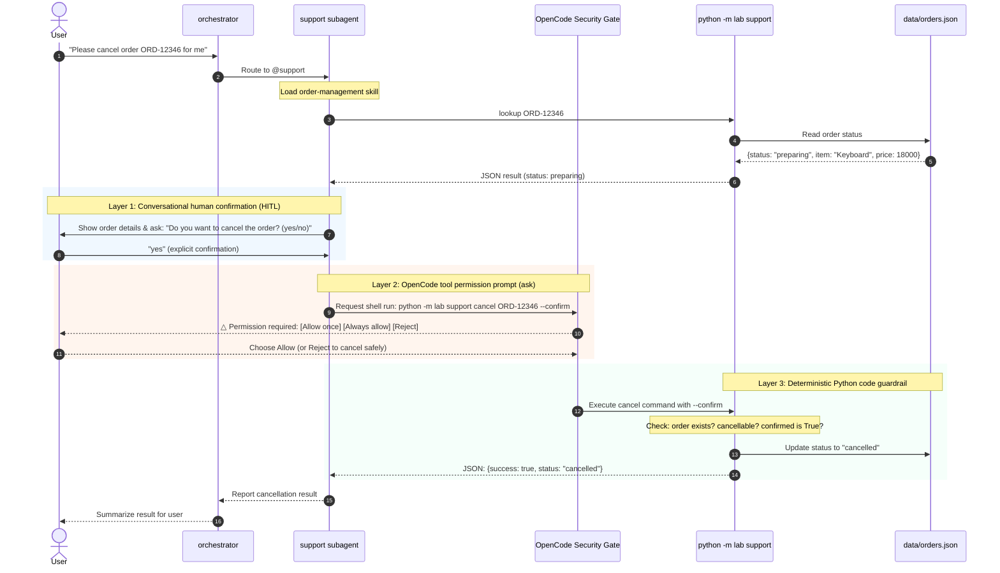
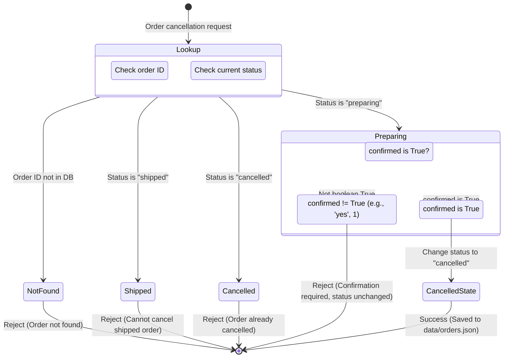

```markdown
# System Specification: Architecture, Code Walkthrough, and Setup Guide

## 1. Purpose

This is a sample assistant for travel and customer support. OpenCode provides the
conversational interface with the LLM and coordinates agents. Python handles
parts that require calculation, validation, and state persistence: calling
weather APIs, computing costs, checking order-cancellation conditions, saving
preferences, and searching documents.

Simply put: the LLM reads requests, selects agents/tools, and explains
results. Only the Python program computes budgets or modifies orders. The LLM
cannot add money on its own, fabricate API results, or confirm actions on behalf
of the user.

## 2. Architecture Diagram



The model configured for the project is `ollama/mimo-v2.6:9b`, calling the
OpenAI-compatible endpoint `http://172.16.125.141:11434/v1`. Checking Ollama via
`/api/tags` already shows the `mimo-v2.6:9b` tag. `opencode.json` defines the
provider, default model, default agent, and tool permissions.

## 3. What Is an Agent?

An agent is saved instructions paired with a role, execution mode, and tool
permissions. It is not a separate database or Python process.

* **Primary agent** is where OpenCode receives the initial request. Here, it is
`orchestrator`.
* **Subagent** is a specialist invoked by the primary agent. Each subagent
receives a short task with focused context.
* After a subagent responds, the orchestrator synthesizes the answer for the
user.
* A subagent does not necessarily know the entire parent conversation. The
orchestrator must pass the right city, order ID, and user/scope.

| Agent | Role | Primary Tool Permissions |
| --- | --- | --- |
| `orchestrator` | Classify requests, invoke specialists, combine results | Only invoke the four allowed subagents; run `lab doctor` |
| `weather` | Current weather | `python -m lab weather ...` |
| `travel` | Itineraries, preferences, budgets | `travel`, `budget`, `search`, read memory; limited web research |
| `support` | Orders, policies, reviews | Lookup and search; cancel requires `ask` |
| `memory` | User-stated preferences | `memory set/list/forget` |

Each agent's prompt and frontmatter live in `.opencode/agents/<name>.md`. The
frontmatter describes name/mode/permissions; the Markdown body contains role
instructions. `orchestrator` is the primary agent; the other four are
subagents. Reusable workflows live in `.opencode/skills/`, such as the
`order-management` skill, which requires looking up the order, presenting
details to the customer, and asking for confirmation before canceling.

`opencode.json` uses OpenCode V2 permissions: it denies action `*` by default,
then enables only the necessary shell commands, subagents, web access, or
skills. The order-cancellation command is set to `ask`. In OpenCode V2, the
new names are `permissions`, `shell`, and `subagent`; V1 previously used
`permission`, `bash`, and `task`. Legacy Markdown frontmatter is still read by
OpenCode 2.2.6, while JSON adds V2 guardrails.

## 4. Easy-to-Follow Code Flows

### Example 1: Asking About Tokyo Weather



1. The orchestrator routes the question to the `weather` agent.
2. The weather agent runs `python -m lab weather Tokyo`.
3. `build_parser()` in `lab/__main__.py` parses the command.
4. `cmd_weather` calls `fetch_weather` in `lab/core.py`.
5. `fetch_weather` validates input, calls the Geocoding API to get coordinates,
and then calls the Forecast API to get current conditions. Both calls go
through `_get_json`.
6. The CLI prints JSON containing `temperature_c`, `humidity_pct`,
`conditions`, `observed_at`, and attribution. The agent only interprets the
JSON it receives.

Tests use a mock API by replacing `_get_json`, so tests do not need network
access.

### Example 2: Planning and Budgeting



1. The travel agent reads preferences and searches content in `knowledge`.
2. The LLM drafts an expense list, marking unverified items as estimates.
3. The agent passes the JSON list into `python -m lab budget ... --limit ...`.
4. `cmd_budget` reads the JSON; `compute_budget_summary` validates the limit,
each item, cost, and estimate flag.
5. Python computes `known_total_yen`, `estimated_total_yen`,
`projected_total_yen`, remaining funds, and within-budget status.
6. `run_bounded_review` calls the reviewer sequentially without exceeding the
cap. If unapproved, it returns `needs_attention`.

Thus, the LLM can propose data, but it is not a calculator that sums costs.

### Example 3: Order Cancellation Request



1. The support agent reads the order-management skill.
2. It calls `support lookup ORD-12346`; `lookup_order` normalizes the ID.
3. If the order does not exist, is already shipped, is already canceled, or
cannot be canceled, Python rejects it.
4. If it can be canceled, the agent displays the ID, item, price, and status
and asks the customer.
5. Only after receiving user confirmation does it send the `--confirm` command.
6. OpenCode adds an `ask` shell permission prompt. Afterward, `cancel_order`
still requires the Python value to be strictly `True` before changing
status.
7. The CLI saves the demo state to `data/orders.json`.

There are two separate layers: the customer confirming the action and OpenCode
allowing tool execution. Neither layer replaces state validation in Python.

### Example 4: Memory and RAG

* Memory: `set_preference` validates fields and upserts into SQLite by
`(user_id, scope, key)`. `forget_preference` deletes only that exact key.
SQL uses `?` placeholders and parameters, without concatenating input into
SQL strings.
* RAG: `load_knowledge` splits Markdown files into passages. `tokenize`
converts Latin text to lowercase words/removes stopwords and converts
Japanese into 2-character bigrams. `simple_keyword_rag` counts shared
distinct tokens, drops score `0`, ranks higher scores first, and preserves
original order on ties.
* `search_knowledge` returns the original passage along with the source file
so the agent can cite it.

This is local keyword retrieval, not yet a vector database or embedding RAG.

## 5. Reading the Project in Order

| File | Question That Helps Understand the File |
| --- | --- |
| `lab/__main__.py` | Where does a CLI command travel on its way to a JSON handler? |
| `lab/core.py` | How is the weather API called twice, and how are errors returned? |
| `lab/travel.py` | How does Python separate confirmed/estimated items and cap loops? |
| `lab/support.py` | Which order statuses are blocked, and when does state actually change? |
| `lab/memory.py` | How are user/scope isolated, and how are Japanese bigrams scored? |
| `.opencode/agents/*.md` | Which agent handles a request, and what tool permissions does it have? |
| `.opencode/skills/*/SKILL.md` | What is the exact safe workflow for an operation? |
| `tests/test_capstone.py` | What inputs do tests use to prove behavior? |

How to study: find `build_parser()` -> check `cmd_*` -> trace functions in the
domain module -> read the corresponding test. No need to read the entire repo
at once.

## 6. Installing Python and Packages in WSL Ubuntu

Open WSL and use the Linux path `/home/ducanh/lab7-starter`, not the Windows
path `/mnt/c/...`. Ubuntu currently has system Python 3.10, which is older
than the required `>=3.11`. Use `uv` to install Python 3.11.18 separately
without replacing system Python:

```bash
cd /home/ducanh/lab7-starter
uv python install 3.11
uv venv --python 3.11 .venv
uv pip install --python .venv/bin/python -r requirements.txt
source .venv/bin/activate
python --version
python -m lab doctor
python -m pytest -v
python -m lab search-eval

```

`.venv/` is a local environment and is already ignored by Git.

## 7. Installing OpenCode and Running with Ollama

Install the CLI using the official Linux installer:

```bash
curl -fsSL [https://opencode.ai/v2/install](https://opencode.ai/v2/install) | bash
export PATH="$HOME/.opencode/bin:$PATH"
opencode --version

```

The installation returned `opencode v2.2.6`. To call the model:

```bash
curl -fsS [http://172.16.125.141:11434/api/tags](http://172.16.125.141:11434/api/tags)

```

The output should include `mimo-v2.6:9b`. Then run from the repo, making sure
both the Python venv and OpenCode are in `PATH`:

```bash
export PATH="/home/ducanh/lab7-starter/.venv/bin:$HOME/.opencode/bin:$PATH"
cd /home/ducanh/lab7-starter
opencode --standalone

```

`--standalone` helps the child server inherit the current shell's `PATH` and
environment variables. You can also run without opening the TUI:

```bash
opencode --standalone run --agent weather Tokyo

```

Headless `run` is suitable for smoke-testing, but cannot type answers into
interactive confirmation prompts like the TUI does.

`opencode.json` declares the base URL, model, default agent, and permissions.
`.env` alongside `.env.example` records `OLLAMA_BASE_URL`, `OLLAMA_MODEL`, and
`LAB_DB_PATH`. OpenCode and Python do not auto-load `.env`; if you change the
IP, update the endpoint in both `opencode.json` and `.env` together.

## 8. Guardrails



* Budget: non-negative integer limit; cost must be finite, integer, and
non-negative; estimate items are still added to projected total.
* Review: stops when approved or when rounds run out; if rounds run out, does
not report success.
* Support: blocks invalid orders before asking for confirmation; only boolean
`True` changes state.
* Memory: parameterized SQL; every operation is scoped to user/scope/key.
* RAG/review/web: content is treated as data, never granting permissions or
triggering actions.
* Weather: network/response errors return a JSON error, without fabricating
data.

## 9. Limitations

RAG is keyword search, so it can miss synonyms not present in the documents.
The eval suite is a small sample, not a guarantee of general quality. Orders
are demo data only. Seeing Ollama return a model tag only confirms the
endpoint/model name, not model provenance. Headless testing does not prove a
real human confirmed an action.

```

```